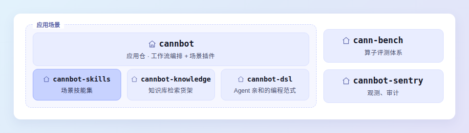

# CANNBot Skills


[](https://www.npmjs.com/package/@cannbot-ai/install-helper)
[](https://agentskills.io)

[](https://github.com/git-ai-project/git-ai)

📖 [安装指南](docs/installation-guide.md) · 📋 [功能清单](docs/feature-list.md) · 🏗️ [架构设计](docs/architecture-design.md) · 🔥 [CHANGELOG](CHANGELOG.md) · 💬 [使用样例](docs/skills-usage.md)

---

## 📢 项目概述

CANNBot 是 [CANN](https://hiascend.com/software/cann) 社区的 Infra 智能体层，用 Agent 完成 AscendC/PyPTO/TileLang/Triton 等各类语言的算子开发、模型迁移与推理优化，并延伸至图模式、Runtime 等更多 CANN 开发场景。

本仓（cannbot-skills）是其技能仓，提供可复用的 Agent Skills 模块；仓群还包括 [cannbot](https://gitcode.com/cann/cannbot)、[cannbot-knowledge](https://gitcode.com/cann/cannbot-knowledge)、[cannbot-dsl](https://gitcode.com/cann/cannbot-dsl)、[cann-bench](https://gitcode.com/cann/cann-bench)、[cannbot-sentry](https://gitcode.com/cann/cannbot-sentry) 等仓库，结构如下。



**面向用户**：CANN / 昇腾 NPU 各领域开发者（算子开发、图模式、模型推理、Runtime 等），同时欢迎社区开发者共建 Skills 和 Agents。

> 📣 **迁移公告**：本仓 `plugins-official/` 与 `plugins-community/` 插件正逐步迁移至应用仓 [cannbot](https://gitcode.com/cann/cannbot) 统一维护。已迁移：官方 `torch-compile`、`ops-direct-invoke`、`ops-direct-invoke-flash`、`ops-registry-invoke`、`ops-perf-optimize`、`model-infer-optimize`、`pypto-op-orchestrator`，社区 `collaborative-agent-kernel-evolution`、`tilelang2ascendc-ops-generator`。`torch-compile`、`ops-direct-invoke`、`ops-direct-invoke-flash`、`ops-perf-optimize`、`model-infer-optimize`、`ascendc-port-orchestrator`、`collaborative-agent-kernel-evolution`、`pypto-op-orchestrator` 的本仓副本已删除，其余已迁移插件在本仓冻结，一段时间后删除；`install.sh` / `install-helper` 将已迁移插件交由 cannbot 的已发布安装包提供，支持的工具与安装级别以安装助手及应用仓说明为准。

## 🚀 快速开始

### 前置条件

- 任选一种 AI 编程工具：[OpenCode](https://opencode.ai/docs) / [Claude Code](https://code.claude.com/docs/en/setup) / [Trae](https://www.trae.ai) / [Cursor](https://www.cursor.com) / [Codex](https://openai.com/codex) / [GitHub Copilot](https://docs.github.com/en/copilot) / [CodeArts](https://codearts.huaweicloud.com/) / [Qoder](https://qoder.cn) / [DSH](https://github.com/deepseek-ai/deepseek-harness)

### 安装

**完整安装**（推荐，含 Skills + Agents + Workflows，适合端到端开发流程编排）：

#### Linux / macOS

```bash
curl -fsSL https://raw.gitcode.com/cann/cannbot-skills/raw/master/install.sh | bash
```

#### Windows

```powershell
iwr -useb https://raw.gitcode.com/cann/cannbot-skills/raw/master/install.ps1 | iex
```

安装后运行 `install-helper` 启动交互式向导，或 `npx @cannbot-ai/install-helper` 免安装运行。

**独立 Skill 安装**（仅需单个能力，遵循 [Agent Skills](https://agentskills.io) 开放标准）：

```bash
# 浏览可用 Skills
npx skills add https://gitcode.com/cann/cannbot-skills.git --list

# 安装单个 Skill（交互式选择目标工具）
npx skills add https://gitcode.com/cann/cannbot-skills.git --skill ascendc-env-check --agent opencode
```

### 安装后使用

启动 AI 编程工具，直接用自然语言描述需求：

```text
"检查环境"
"开发一个 Abs 算子，输入 float16，输出 float16"
```

> 📖 安装验证、完整命令参考、手动脚本安装与故障排查详见 [安装指南](docs/installation-guide.md)。

## 📐 开发路径与核心能力

全量 Skills/Agents 清单见 [功能清单](docs/feature-list.md)，使用样例见 [Skills 使用样例](docs/skills-usage.md)。

下表仅保留 plugins-official 官方插件入口；领域目录级入口（graph/ runtime/ tools/ 等）与全量清单见 [功能清单](docs/feature-list.md)。

| 领域 / 路径 | 适用场景 | 入口插件 |
|------------|---------|---------|
| **Ascend C 直调** | `<<<>>>` 直接调用核函数 | [ops-direct-invoke（cannbot）](https://gitcode.com/cann/cannbot/tree/master/plugins-official/ops-direct-invoke) / [ops-direct-invoke-flash（cannbot）](https://gitcode.com/cann/cannbot/tree/master/plugins-official/ops-direct-invoke-flash) |
| **Ascend C 注册调用** | ACLNN/GEIR 接入框架的标准算子 | [ops-registry-invoke](plugins-official/ops-registry-invoke/AGENTS.md) |
| **Catlass** | CATLASS C++ 算子五阶段工作流 | [六个 CATLASS C++ Skills](ops/catlass-cpp-interface/SKILL.md)（插件入口位于 [cannbot](https://gitcode.com/cann/cannbot/tree/master/plugins-official/catlass-op-generator)） |
| **PyPTO** | 昇腾原生 Python Tile 算子编程 | [pypto-op-orchestrator（cannbot）](https://gitcode.com/cann/cannbot/tree/master/plugins-official/pypto-op-orchestrator) |
| **TileLang** | 按本机芯片路由，Ascend910 与 Ascend950 工作流及技能独立 | [tilelang-op-orchestrator（cannbot）](https://gitcode.com/cann/cannbot/blob/master/plugins-official/tilelang-op-orchestrator/AGENTS.md) |
| **Triton** | `triton_ascend` DSL 生成并优化算子 | triton-op-generator（已迁移至 [cannbot](https://gitcode.com/cann/cannbot) 仓 `plugins-official/triton-op-generator`） |
| **torch.compile 图模式** | npugraph_ex 图捕获与重放 | [torch-compile（cannbot）](https://gitcode.com/cann/cannbot/tree/master/plugins-official/torch-compile) |
| **模型推理优化** | 固定阶段优化与 baseline 之上的 SOTA 探索优化 | [model-infer-optimize（cannbot）](https://gitcode.com/cann/cannbot/tree/master/plugins-official/model-infer-optimize) |
| **模型训练调测** | 训练精度诊断（有限值偏差 / 非有限值 / 确定性）、OOM 内存诊断与训练日志可视化 | [model-train-precision-diagnose（cannbot）](https://gitcode.com/cann/cannbot/tree/master/plugins-community/model-train-precision-diagnose) / [model-train-skills](docs/feature-list.md#npu-模型训练调测) |

## 🔍 项目架构

### 目录结构

```
cannbot-skills/
├── ops/                  # 算子 Skills
├── model/                # 模型推理优化 Skills
├── graph/                # 图模式 Skills
├── runtime/              # Runtime Skills
├── infra/                # 基础设施 Skills（治理 / GitCode 协作）
├── tools/                # CANN 工具链 Skills（asys / msaicerr / msnpureport / npu-compute / npu-check / npu-objdump）
├── plugins-official/     # 官方 Plugins（开发路径入口，含 Agents/Workflows）
├── plugins-community/    # 社区 Plugins
├── docs/                 # 项目文档
└── tests/                # 自动化测试框架
```

### 三层架构

三层架构：Plugin 编排 Agents，Agents 绑定 Skills。

- **Plugin**（应用编排层）— 通过 `AGENTS.md` 定义各 Agent 协作顺序
- **Agent**（角色执行层）— 承担方案设计、代码开发、代码检视等职责
- **Skill**（知识能力层）— 提供领域知识与工程模板

以 Ascend C 算子开发为例（`ops-direct-invoke` 的当前编排与角色定义见 [cannbot 应用仓](https://gitcode.com/cann/cannbot/tree/master/plugins-official/ops-direct-invoke)）：

```
╔═══════════════════════════════════════════════════════════════════════════════╗
║                             PLUGINS（应用编排层）                              ║
╠═══════════════════════════════════════════════════════════════════════════════╣
║                                                                               ║
║  ┌─────────────────────────────┐        ┌─────────────────────────────┐       ║
║  │  ops-direct-invoke          │        │  ops-registry-invoke        │       ║
║  │  Kernel 直调开发流程         │        │  算子注册调用开发流程         │       ║
║  └──────┬──────┬──────┬────────┘        └──────┬──────┬──────┬────────┘       ║
║         │      │      │                        │      │      │                ║
╚═════════╪══════╪══════╪════════════════════════╪══════╪══════╪════════════════╝
          │      │      │                        │      │      │
          ▼      ▼      ▼                        ▼      ▼      ▼
╔═══════════════════════════════════════════════════════════════════════════════╗
║                             AGENTS（角色执行层）                               ║
╠═══════════════════════════════════════════════════════════════════════════════╣
║                                                                               ║
║  ┌──────────────┐  ┌──────────────┐  ┌──────────────┐  ┌──────────────┐       ║
║  │  architect   │  │  developer   │  │  reviewer    │  │  tester      │       ║
║  │   方案设计    │  │   代码开发   │  │   代码检视    │  │   代码测试    │       ║
║  └──────────────┘  └──────────────┘  └──────────────┘  └──────────────┘       ║
║                                                                               ║
╚═══════════════════════════════════════════════════════════════════════════════╝
             │ │ │ │       │ │ │ │       │ │ │ │       │ │ │ │
             ▼ ▼ ▼ ▼       ▼ ▼ ▼ ▼       ▼ ▼ ▼ ▼       ▼ ▼ ▼ ▼
╔═══════════════════════════════════════════════════════════════════════════════╗
║                             SKILLS（知识能力层）                               ║
╠═══════════════════════════════════════════════════════════════════════════════╣
║                                                                               ║
║  ┌─ 知识库类 ──────────────────────────────────────────────────────────────┐  ║
║  │  npu-arch                   NPU 架构知识与芯片映射                       │  ║
║  │  ascendc-tiling-design      Tiling 设计方法论                           │  ║
║  │  ascendc-api-best-practices API 使用最佳实践                            │  ║
║  │  ops-precision-standard     算子精度标准                                │  ║
║  └────────────────────────────────────────────────────────────────────────┘  ║
║                                                                              ║
║  ┌─ 工程模板类 ────────────────────────────────────────────────────────────┐  ║
║  │  ascendc-registry-invoke-to-direct-invoke 注册算子直调改造模板           │  ║
║  │  ascendc-direct-invoke-template           Kernel直调工程模板             │ ║
║  └─────────────────────────────────────────────────────────────────────────┘ ║
║                                                                              ║
║  ┌─ 调试与测试类 ──────────────────────────────────────────────────────────┐  ║
║  │  ascendc-precision-debug 精度调试与症状速查                              │  ║
║  │  ascendc-runtime-debug   运行时错误码解析                                │  ║
║  │  ascendc-crash-debug     卡死/崩溃调试、Coredump 分析                    │  ║
║  │  ascendc-sync-audit    信号同步检验与修正（SetFlag/WaitFlag/CrossCore） │  ║
║  │  ascendc-env-check       NPU 设备查询与环境验证                          │  ║
║  └─────────────────────────────────────────────────────────────────────────┘ ║
║                                                                              ║
║  ┌─ 测试开发类 ────────────────────────────────────────────────────────────┐  ║
║  │  ascendc-st-design   ST 测试用例设计                                    │  ║
║  │  ascendc-ut-develop  UT 开发与覆盖率增强                                │  ║
║  │  ascendc-code-review 代码检视规则                                       │  ║
║  └────────────────────────────────────────────────────────────────────────┘  ║
║                                                                              ║
║  ┌─ 工具辅助类 ────────────────────────────────────────────────────────────┐  ║
║  │  ops-profiling      算子性能采集分析                                     │  ║
║  └─────────────────────────────────────────────────────────────────────────┘  ║
║                                                                               ║
╚═══════════════════════════════════════════════════════════════════════════════╝
```

> 架构设计详情和各开发路径的逻辑架构图见 [项目架构设计](docs/architecture-design.md)。

## 🔥 最新动态

最新更新与历史记录详见 [CHANGELOG.md](CHANGELOG.md)。

## 💬 相关信息
- [贡献指南](docs/CONTRIBUTING.md) — 贡献流程、准入门槛、评审规则
- [AI 归因标记](docs/CONTRIBUTING.md#ai-辅助贡献的归因标记推荐) — 标记 AI 生成的代码行，安装 git-ai 自动生效
- [治理模型](docs/GOVERNANCE.md) — 成文法+判例法、角色职责
- [开发规范](docs/STANDARDS.md) — 命名规范、结构规范、分类体系
- [测试框架](tests/README.md) — 自动化测试验证 Skills 和 Agents 的正确性
- [许可证](LICENSE) — 基于 CANN Open Software License v2.0
- [所属 SIG](https://gitcode.com/cann/community/tree/master/CANN/sigs/cannbot)

## 💖 免责声明

感谢您关注 CANNBot Skills 项目，希望这些技能和知识能帮助您更好地进行 CANN 开发 ^_^

1. **功能满足度**：由于技术快速迭代，部分内容可能无法完全适用于所有场景。功能与文档持续完善中，欢迎提 Issue 或参与讨论。
2. **自动生成内容**：自动生成的代码受模型、Skills 能力、语料质量、输入指令等多因素影响，无法保证完全精准。生成代码仅作辅助研发使用，请开发者务必测试验证、安全审查后再投入使用。

## 🤝 社区交流

| 渠道 | 适用场景 | 链接 |
|------|---------|------|
| GitCode Issue | Skill bug / 功能缺失 / 项目结构与文档问题 | [提交 Issue](https://gitcode.com/cann/cannbot-skills/issues) |
| GitCode Discussions | 使用疑问 / 经验交流 / 功能建议 | [参与讨论](https://gitcode.com/cann/cannbot-skills/discussions) |
| 微信交流群 | 实时交流 | [加入群聊](https://gitcode.com/cann/cannbot-skills/discussions/2) |
| CANNBot SIG | 社区治理与项目方向 | [SIG 主页](https://gitcode.com/cann/community/tree/master/CANN/sigs/cannbot) |
